  

<h1 align="center">Mauricio Andreata</h1>

  <b>Systems Integration Engineer · EV Charging Software</b> 
  Python · Flask · OCPP · Azure · Docker · Embedded (ESP32, CAN, MQTT)

  
  

  

I build software for EV chargers and vehicles, from the electronics bench to the cloud.

## Now

- **ElectricFish** (San Carlos, CA, remote from Brazil): Junior Engineer on the Systems Integration Engineering (SIE) team, promoted from intern in January 2026. Full stack on EV fast-charging (EVSE) software: REST APIs, OCPP integration and the internal platform that engineering and operations use daily, co-developed with the CTO.
- **LAMAU / UFU** (volunteer, 2022 to 2026): from member to Project Manager of an electric racing motorcycle project and the lab's R&D with industry sponsors.

## Selected work

<b>Internal operations platform, ElectricFish</b>

 

Co-developed with the CTO. Tracks charger status and charging sessions, aggregates unit logs, sends remote commands over OCPP, and manages parts inventory, build orders and assembly tasks, replacing spreadsheet-based tracking. I work across the full stack: frontend, backend, database, deployment and charger integration.

As an intern, I built the Electron app that runs ads on the charger screens, with scheduling and OCPP DataTransfer communication.

*Production code is private. Public projects that mirror this work are listed below as they ship.*

<b>Tupã 2026, electric racing motorcycle (MotoStudent Electric)</b>

 

Designed for MotoStudent edition 7 and built to completion under my project management. Edition 7 design results: **2nd in Innovation, 3rd in Management Plan**, and the only Latin American team in the competition.

My work: ESP32 data acquisition (C, CAN to the BMS and inverter, MQTT telemetry), a Nextion UART display, a 27s16p high-voltage pack and a 4s8p low-voltage pack (Samsung INR 18650), Sevcon Gen4 inverter setup, motor mounts, fairing and brake system.

<b>Atlas-1RL, Formula SAE electric car</b>

 

Led the team that designed the accumulator pack and container and the electrical safety systems required by the regulations (BSPD, APPS, BSE, BOTS, precharge and discharge circuits, Shutdown Circuit). The lab built the car in 2026, and I supported the electrical team during construction. **10th overall at Formula SAE Brasil.**

## Stack

**Protocols:** OCPP, CAN, MQTT, WebSocket, UART

## Public projects

<!-- Add these cards when each repo is ready, using the pinned-repo layout:
- ocpp-charger-simulator: OCPP charge point simulator, mini central and Flask dashboard
- esp32-can-mqtt-telemetry: ESP32 CAN to MQTT telemetry logger with a virtual-CAN simulation mode
-->

Pinned repositories appear above this section.

---

  Based in Brazil · Working remotely with a US team · English and Portuguese

